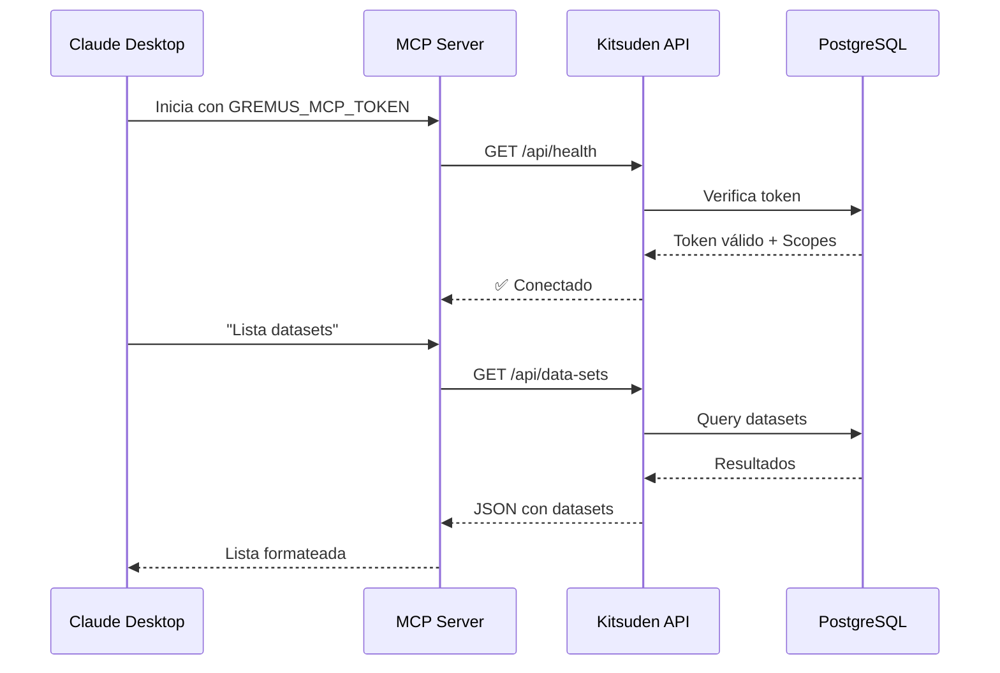

# Guía de Configuración MCP - Kitsuden

> **Fecha:** 2026-03-19  
> **Versión:** 1.0.0  
> **Estado:** ✅ Listo para uso

---

## 📋 Resumen

Esta guía configura la conexión entre **Claude Desktop** y **Kitsuden CMS** mediante el protocolo MCP (Model Context Protocol) con autenticación Zero-Trust.

---

## 🔧 Prerrequisitos

1. ✅ **Kitsuden API corriendo:** `cd apps/api && bun run dev`
2. ✅ **PostgreSQL activo:** `docker compose up -d db`
3. ✅ **Token MCP generado:** Ver `progress.txt`

---

## 🚀 Configuración Rápida

### Paso 1: Generar Token MCP (si no lo has hecho)

```bash
cd apps/api
bun run seed:mcp
```

Esto generará:

- Un agente "DevBot" en la base de datos
- Un token con formato `kitsuden_agent_...`
- Configuración para Claude Desktop

**Ver el token en:** `progress.txt`

---

### Paso 2: Configurar Claude Desktop

1. **Abre** Claude Desktop
2. **Ve a:** Configuración (Settings) → Developer → Edit Config
3. **Abre** el archivo `claude_desktop_config.json`

4. **Añade** esta configuración:

```json
{
  "mcpServers": {
    "kitsuden": {
      "command": "bun",
      "args": ["run", "apps/api/src/mcp-server.ts"],
      "cwd": "C:\\Users\\vantinori\\Documents\\github\\cms",
      "env": {
        "GREMUS_MCP_TOKEN": "<YOUR_AGENT_KEY>",
        "GREMUS_API_URL": "http://localhost:3001",
        "NODE_ENV": "development"
      }
    }
  }
}
```

⚠️ **IMPORTANTE:** Reemplaza el token con el que generaste en `progress.txt`

---

### Paso 3: Reiniciar Claude Desktop

1. **Cierra** completamente Claude Desktop
2. **Vuelve a abrirlo**
3. Espera a que cargue el servidor MCP (aparecerá "kitsuden" en la lista de servidores)

---

## 🧪 Probar la Conexión

### Test 1: Verificar herramientas disponibles

Escribe en Claude:

```
Lista las herramientas que tienes disponibles
```

**Respuesta esperada:**

```
Tengo disponibles las siguientes herramientas de Kitsuden:

1. **kitsuden_list_datasets** - Lista todos los datasets
2. **kitsuden_search_entries** - Busca en datasets
3. **kitsuden_create_entry** - Crea entradas
4. **kitsuden_read_entry** - Lee entradas
5. **kitsuden_update_entry** - Actualiza entradas
6. **kitsuden_get_dataset_schema** - Obtiene esquema
7. **kitsuden_health_check** - Verifica conexión
```

---

### Test 2: Verificar estado de la API

Escribe:

```
Verifica el estado de la conexión con Kitsuden
```

**Respuesta esperada:**

```
✅ Kitsuden API está saludable!

Estado: ok
Servicio: kitsuden-api
Versión: 0.8.0-beta

Checks:
- database: ok
- queue: ok
- realtime: ok
- memory: ok
```

---

### Test 3: Listar datasets

Escribe:

```
Muestra los datasets disponibles en Kitsuden
```

**Respuesta esperada:**

```
📊 Datasets disponibles (3):

- **products** (ID: uuid-123)
  Slug: products
  Descripción: Catálogo de productos

- **blog-posts** (ID: uuid-456)
  Slug: blog-posts
  Descripción: Publicaciones del blog
```

---

## 🔐 Seguridad Zero-Trust

### ¿Cómo funciona?

```
Claude Desktop → Token kitsuden_agent_xxx → Middleware → Validación → Acceso
```

1. **Formato del token:** `kitsuden_agent_{tipo}_{hash}`
2. **Verificación:** Hash SHA-256 en base de datos
3. **Scopes:** Verificación de permisos por herramienta
4. **Rate limiting:** 120 req/min por agente
5. **Auditoría:** Cada acción se registra en `agent_audit_logs`

### Scopes del Agente DevBot

```json
["read:issues", "write:intake"]
```

Esto significa que el agente puede:

- ✅ Leer datasets y entradas
- ✅ Escribir en datasets (crear/actualizar)
- ❌ No puede acceder a funciones de admin

---

## 🛠️ Herramientas MCP Disponibles

| Herramienta                   | Descripción              | Scopes Requeridos |
| ----------------------------- | ------------------------ | ----------------- |
| `kitsuden_list_datasets`      | Lista todos los datasets | `read:issues`     |
| `kitsuden_search_entries`     | Busca en datasets        | `read:issues`     |
| `kitsuden_create_entry`       | Crea nueva entrada       | `write:intake`    |
| `kitsuden_read_entry`         | Lee entrada específica   | `read:issues`     |
| `kitsuden_update_entry`       | Actualiza entrada        | `write:intake`    |
| `kitsuden_get_dataset_schema` | Obtiene esquema          | `read:issues`     |
| `kitsuden_health_check`       | Verifica conexión        | -                 |

---

## 🐛 Troubleshooting

### Error: "GREMUS_MCP_TOKEN no está configurado"

**Solución:**

```bash
# Generar token
bun run apps/api/scripts/seed-mcp-test.ts

# Copiar token de progress.txt
```

---

### Error: "Invalid agent API key"

**Causas:**

1. Token no registrado en base de datos
2. Token expirado
3. Agente desactivado

**Solución:**

```bash
# Verificar que PostgreSQL esté corriendo
docker compose up -d db

# Ejecutar script SQL de registro
psql -d kitsuden_dev -f - << EOF
INSERT INTO agent_identities (id, name, type, scopes, is_active)
VALUES ('agent_test', 'DevBot', 'claude-desktop', '["read:issues", "write:intake"]', true);

INSERT INTO agent_api_keys (agent_id, key_hash, key_prefix)
VALUES ('agent_test', 'hash_aqui', 'kitsuden_agent_****');
EOF
```

---

### Error: "Agent does not have MCP scope"

**Solución:** Actualizar scopes del agente:

```sql
UPDATE agent_identities
SET scopes = '["read:issues", "write:intake", "mcp:connect"]'
WHERE name = 'DevBot';
```

---

### Error: "Connection refused" al conectar

**Verificar:**

1. Kitsuden API corriendo:
   ```bash
   cd apps/api && bun run dev
   ```
2. Puerto correcto en `GREMUS_API_URL`:
   ```json
   "GREMUS_API_URL": "http://localhost:3001"
   ```

---

## 📊 Verificar Logs

### Logs del servidor MCP

En Claude Desktop → Developer → MCP Logs

### Logs de auditoría en Kitsuden

```sql
-- Ver últimas acciones del agente
SELECT * FROM agent_audit_logs
WHERE agent_id = 'agent_xxx'
ORDER BY created_at DESC
LIMIT 10;
```

---

## 🔁 Flujo Completo de Conexión



---

## 📁 Archivos Relacionados

| Archivo                             | Propósito               |
| ----------------------------------- | ----------------------- |
| `apps/api/src/mcp-server.ts`        | Servidor MCP standalone |
| `apps/api/src/routes/mcp.ts`        | Endpoints MCP HTTP/SSE  |
| `apps/api/scripts/seed-mcp-test.ts` | Generador de tokens     |
| `progress.txt`                      | Token guardado          |
| `MCP_SETUP_GUIDE.md`                | Esta guía               |

---

## ✅ Checklist de Verificación

- [ ] Token generado en `progress.txt`
- [ ] PostgreSQL corriendo
- [ ] Kitsuden API corriendo (`bun run dev`)
- [ ] Configuración en `claude_desktop_config.json`
- [ ] Claude Desktop reiniciado
- [ ] Test "Lista herramientas" funciona
- [ ] Test "Verifica estado" funciona
- [ ] Test "Lista datasets" funciona

---

## 🆘 Soporte

Si encuentras problemas:

1. Verifica logs: Claude Desktop → Developer → MCP Logs
2. Verifica API: `curl http://localhost:3001/api/health`
3. Verifica token: `cat progress.txt`
4. Revisa conexión DB: `docker compose ps`

---

**¡Listo!** Claude Desktop ahora está conectado a Kitsuden con seguridad Zero-Trust.
